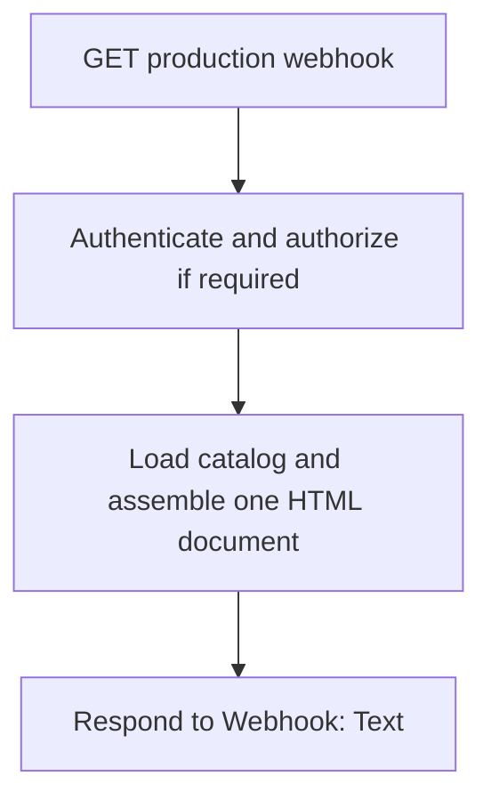

# Build and serve the reporting hub with n8n and Power BI

Reference date: November 6, 2026. This is an implementation guide, not a deployed workflow or confirmation of the tenant's configuration.

The intended result is a lightweight directory embedded in a Power BI Org app. It shows each report's title, a brief description, relevant finance topics, a few key tabs, and a destination link. The report itself remains the place for detailed instructions and analysis.

## Choosing the implementation

These are contextual recommendations for a report directory, rather than a claim that one platform is always best.

| Option | When it fits | Recommendation here |
|---|---|---|
| Native Org app overview | Built-in navigation and audience-aware content are enough | Lowest-maintenance baseline; try it before adding custom hosting |
| Plain HTML/CSS/JavaScript with a JSON catalog | Custom typography, local search, topic filters, and responsive layouts matter | Best fit for continuing the existing HTML approach; n8n can serve the bundled document |
| A Power BI welcome report | Native report-canvas editing and buttons are preferred | Reasonable fallback; maintain the welcome report as another report artifact |
| Python visual | Python-generated analytical plots are needed | Unsuitable for clickable navigation: its rendered image is not interactive |
| Power Apps | The page needs forms, data entry, or other business actions | Additional application and sharing work is unnecessary for this read-only catalog |
| Power Automate | A viewer intentionally triggers a workflow | A flow button does not provide the directory layout; no flow is needed for local filtering |

HTML supplies structure, CSS supplies styling, JavaScript supplies interactions, and JSON stores the catalog. JSON alone is not a page renderer. AI is useful during authoring for code, copy alternatives, and review; the deployed directory does not need runtime AI calls.

Sources: [Org apps](https://learn.microsoft.com/en-us/power-bi/explore-reports/org-app-items), [Power BI buttons](https://learn.microsoft.com/en-us/power-bi/create-reports/desktop-buttons), [Python visuals](https://learn.microsoft.com/en-gb/power-bi/connect-data/desktop-python-visuals), [Power Apps visual](https://learn.microsoft.com/en-us/power-apps/maker/canvas-apps/powerapps-custom-visual), and [Power Automate visual](https://learn.microsoft.com/en-us/power-bi/create-reports/power-bi-automate-visual).

## 1. Open the reference on your work PC

1. Sign in to GitHub with the account that has access to this repository.
2. Select branch **`docs/finance-reporting-hub`**, use **Code → Download ZIP**, and extract it. Alternatively, clone that branch. Open **`references/finance-reporting-hub`**; all paths and commands below are relative to that folder.
3. Open `demo/index.html` in a browser to inspect the standalone example. A GitHub file page displays source; it is not a running website.
4. Read `docs/design-guide.md` before changing typography or layout.
5. Edit `data/catalog.example.json` using the existing fields and sample structure. With Node.js 18 or later, run `npm run build` from the reference folder to regenerate `demo/index.html`; no package installation is required.
6. Run `npm run check` and `npm test` for the included static checks. For real destinations, copy the example to the ignored `data/catalog.local.json` and run `node scripts/build.mjs data/catalog.local.json dist/index.html`. Inspect that generated HTML locally before changing a live workflow.

The example catalog contains six fictional entries, not a production inventory. Populate real report URLs and reviewed descriptions in the ignored local catalog. Keep credentials and private access tokens out of every catalog.

## 2. Maintain one catalog

Use one JSON record per report. The implementation uses these exact field names:

| Field | Meaning |
|---|---|
| `id` | Stable unique lowercase ID with hyphens |
| `title` | Recognizable report name, retaining familiar abbreviations |
| `summary` | Brief purpose and any selection-relevant scope distinction |
| `category` | One primary finance category |
| `topics` | Array of additional searchable/filterable finance topics |
| `keyTabs` | Array of verified tab names; use `[]` when none are confirmed |
| `url` | Verified absolute HTTPS destination, or `null` while unconfigured |
| `descriptionStatus` | Optional editorial value, `draft` or `reviewed`; not shown to viewers |

At the catalog level, `title` and `intro` supply the header, `reports` contains the records, and optional `filters` controls the topic buttons. The starter displays the primary category and up to three key tabs, falling back to up to three topics when there are no key tabs. Search includes `title`, `summary`, `category`, `topics`, and `keyTabs`; there is no separate alias field. Keep a familiar original name in the title or summary if the display wording changes.

Practical authoring rules:

- Write summaries that answer “When should I use this report?”
- Aim for one sentence, usually 15–25 words, rather than repeating the title.
- Only list tab names confirmed in the report. Topic labels are not evidence that a report has a tab with that name.
- Give cross-functional reports several searchable tags, but render each report once in a filtered result set.
- Keep owner, refresh, and “link coming soon” out of the landing-page presentation.
- Keep long methodology and reconciliation guidance in the report's own introduction. Retain one short distinction in the catalog only when it materially affects report selection.
- Confirm unfamiliar report abbreviations instead of fabricating their meanings.

Examples of finance topics include Revenue, Inventory, COGS, Scrap, Operating expenses, Close, and Receivables. Only expose categories that have confirmed matching content.

## 3. Assemble a single HTML response

The serving pattern is:



For a small directory, the HTML, styles, small JavaScript renderer, and catalog can be bundled in one document. This avoids runtime dependencies for the first render and allows browser-side filtering after the initial response.

If the frontend is already available as a complete generated HTML file, the workflow only needs to obtain that file's contents and return them. If assembling it in a Code node, return a single item containing the final HTML string, for example:

```javascript
// Code node, Run Once for All Items.
// Assume an earlier approved step supplies a complete HTML string.
const html = $input.first().json.html;
if (typeof html !== 'string' || !html.trim()) {
  throw new Error('The reporting hub HTML is missing.');
}
return [{ json: { html } }];
```

This example validates the shape; it does not retrieve a file or build the page by itself. Choose a file/catalog source appropriate to the actual n8n deployment. Do not assume n8n Cloud can read an arbitrary work-PC filesystem path.

If embedding JSON into a `<script>` element, serialize it safely and escape `<` as `\u003c` so unexpected catalog text cannot terminate the element. Render catalog text with `textContent`; do not interpolate unchecked catalog text into raw HTML. Validate destination protocols before creating links.

## 4. Configure the n8n nodes

| Node/setting | Value or behavior |
|---|---|
| Webhook HTTP method | `GET` for the directory |
| Webhook path | A stable path such as `finance-reporting-hub` |
| Webhook Respond | **Using 'Respond to Webhook' node** |
| Response node Respond With | **Text** |
| Response Body | Expression `{{ $json.html }}` when the previous item has an `html` property |
| Content type | `text/html; charset=utf-8`; Text responses send HTML by default |
| Response code | `200` for a successfully rendered directory |

The response node runs once and uses the first incoming item. Assemble the entire catalog page before it rather than expecting one response per report. Ensure error and denied-access paths return deliberate appropriate responses. A workflow that finishes without reaching the response node can produce an unintended default success response.

Use the **Test URL** only while testing with the webhook listening. For the Org app, use the **Production URL** after activating or publishing the workflow as required by the installed n8n version. Copy the URL directly from the Webhook node. Verify a normal browser can load it without the editor waiting for a test event.

Official references: [Respond to Webhook](https://docs.n8n.io/integrations/builtin/core-nodes/n8n-nodes-base.respondtowebhook/) and [Webhook](https://docs.n8n.io/integrations/builtin/core-nodes/n8n-nodes-base.webhook/).

## 5. Account for n8n's HTML sandbox

n8n introduced automatic iframe wrapping of HTML webhook responses in version 1.103.0. Its current documentation states that HTML renders in a sandboxed iframe, attempts to access the top-level window or local storage fail, original authentication headers are unavailable inside the frame, and relative URLs do not work.

For this directory:

- Use absolute HTTPS URLs for report destinations and externally hosted assets.
- Keep search, selected topics, and optional view mode in ordinary in-memory page state.
- Do not depend on `window.parent`, `window.top`, or `localStorage`.
- Do not assume an embedded page can control Power BI's surrounding navigation.
- Test target-link behavior in the real embedded page. A new-tab destination is an explicit navigation choice, not a guarantee of arbitrary iframe capability.
- Test any external font or image in the actual deployment; browser policy and the host can affect loading.

Keep an initial version self-contained where practical. If requirements later grow into persistent preferences, complex routing, or a sophisticated authenticated app, consider a separately hosted frontend behind the company's identity system, with n8n handling the appropriate backend workflows.

## 6. Add the directory to the Power BI Org app

This guidance is for **Org apps**, not the older workspace app publishing model.

1. Open the Org app in edit mode.
2. Select **Add → Link**.
3. Name it something clear, such as **Welcome** or **Reporting hub**.
4. Paste the production URL that serves the HTML.
5. Choose the option to open it **within the app**.
6. Move that navigation item to the first position if it should be the default landing experience.
7. Use the app's preview to check its width, navigation, and report links.
8. Save when ready for the people who already have access to see the change. This repository does not perform that save or change audience membership.

Microsoft documents that an external link can open inside the app or in a new tab, and that the first navigation element is the app landing experience. Deep links to specific app items can still take viewers directly to those items.

Sources: [Planning solutions with Org apps](https://learn.microsoft.com/en-us/fabric/iq/plan/resources/how-to-create-org-apps) and [Get started with Org apps](https://learn.microsoft.com/en-us/power-bi/explore-reports/org-app-items).

## 7. Obtain and verify report destinations

For a report included in the Org app, open that report in the app and use **Share → Link to this app page**. Store the resulting destination in its catalog record. This preserves an intentional app destination rather than relying on an authoring-workspace URL.

Test each destination as an ordinary intended viewer. Confirm the report and starting page, the authentication behavior, and whether the chosen new-tab or in-frame experience behaves as expected. Do not assume that changing a link's HTML target can make it select an item in Power BI's parent navigation. Do not embed an entire app recursively to achieve navigation.

If individual tab URLs are not verified, display key tabs as passive labels. Make them separate links only when there is a working destination for each. Never nest clickable tab links inside an already clickable card link.

## 8. Keep access decisions at the right boundary

A link does not grant report access. Power BI checks the destination user's existing permissions. Separately, adding native content to an Org app and changing audiences can affect access; do not confuse those product actions with adding an ordinary hyperlink to this directory.

The HTML host has its own access configuration. Power BI audience membership does not automatically secure an arbitrary external webpage, and static JavaScript filtering is not authorization. If names or descriptions must be audience-specific, filter the catalog at a trusted server boundary using verified identity, or use separately permissioned catalogs.

Never put shared n8n credentials, service tokens, API keys, or admin secrets in HTML or JSON delivered to browsers. Use the organization's existing approved hosting and identity pattern. The directory should not need database access or AI inference just to display its report list.

## 9. Distinguish the two warning areas

An HTML directory's own yellow “Read before using” block is page content and can be removed or reduced to a short selection-relevant note. Detailed caveats belong in the report's own introduction.

The Microsoft external-content notice above the embedded page is part of the Power BI host interface. The directory's CSS cannot restyle a cross-origin parent interface. No supported setting to remove that notice is established by this reference; do not plan around a CSS workaround.

Reference: [MDN same-origin policy](https://developer.mozilla.org/en-US/docs/Web/Security/Same-origin_policy).

## 10. Keep the directory fast

Load the catalog once and search/filter it locally. Avoid report previews that load twenty embedded reports, database queries on every keystroke, AI-generated descriptions on every visit, video backgrounds, and a large application framework for a small static directory.

Use an installed system font stack where practical. If a header image is used, provide its dimensions and an appropriately compressed asset so its arrival does not move the report collection. Measure the directory and the reports separately: a fast catalog does not speed up a slow Power BI model query or visual render.

The acceptance checks are in [implementation-checklist.md](implementation-checklist.md).
